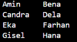
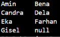
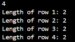
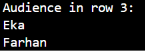
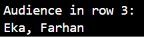
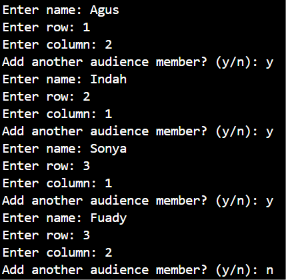
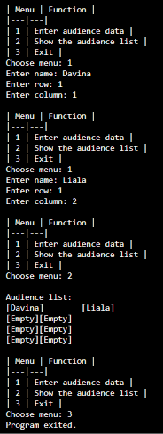
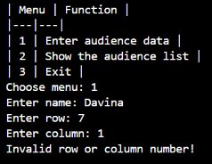
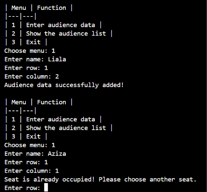
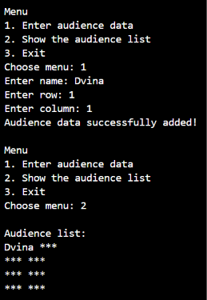

# REPORT JOBSHEET 11: 2 Dimensional Array

Name: Davina Tegar Putri Ervia

NIM: 264107020083

GitHub: https://github.com/davinategar

# A. Learning Outcomes

After completing this jobsheet, students are able to:

* Declare, instantiate, and initialize 2-dimensional arrays in Java.
* Access and fill elements of a 2-dimensional array using row and column indices.
* Process 2-dimensional arrays with nested loops, using both for and foreach.
* Create 2-dimensional arrays whose rows have different lengths (*jagged arrays*).
* Compute row averages and column averages in a real case study.

# B. Experiment Map

| Experiment | Case Study                  | Topic                                      | New Concept                         |
|-----------|-----------------------------|--------------------------------------------|-------------------------------------|
| 1         | Mini cinema                | Declaration, initialization, and access     | Row and column indices, `length`, `foreach` |
| 2         | Cinema with Scanner         | Interactive input and menu                 | Nested input, index validation, `null` |
| 3         | Numbers                     | 2-dimensional array with rows of different lengths | `new int[3][]`, length of each row |
| 4         | SIAKAD (academic system)   | Student score case study                   | Row and column averages             |

# C. Step-by-Step Instructions

## Experiment 1: Declaration, Initialization, and Displaying a 2-DimensionalArray

**The Code:**

```
public class cinema07 {
    public static void main(String[] args) {
        String [][] audience = new String[4][2];

        audience [0][0] = "Amin";
        audience [0][1] = "Bena";
        audience [1][0] = "Candra";
        audience [1][1] = "Dela";
        audience [2][0] = "Eka";
        audience [2][1] = "Farhan";
        audience [3][0] = "Gisel";
        audience [3][1] = "Hana";

        System.out.printf("%s \t %s\n", audience [0][0], audience[0][1]);
        System.out.printf("%s \t %s\n", audience [1][0], audience[1][1]);
        System.out.printf("%s \t %s\n", audience [2][0], audience[2][1]);
        System.out.printf("%s \t %s\n", audience [3][0], audience[3][1]);
    }
}
```

**The Result:**



**Question Experiment 1:**

1. Must the elements of an array be filled in order, starting from index 0? Explain!

   **Answer:**
   No, array elements do not have to be filled in order, starting from index 0. We can fill array elements in any order, as long as we use valid indices. Because each array element has its own index (position). The index is used to access a specific element, so Java doesn't require us to fill the elements in a particular order.

2. Temporarily comment out the line ```audience[3][1] = "Hana";```, then compile and run again.What is printed for row 4 now? Explain using the default values of arrays.   

   **Answer:**
   If we temporarily comment out this line: ```//audience [3][1] = "Hana";```, The result will be

   

   When we create an array using: ```String[][] audience = new String[4][2];```, Java automatically fills all elements of a String array with null by default. null means that the element does not currently contain any String value.

4. Restore the line you commented out in Question 2. Why is it important to fill every elementbefore the array is displayed?

   **Answer:**
   It is important to fill every element of the array before displaying it so that every seat has a name instead of an empty value (null). If we don't fill all the elements, Java will display null for the elements that haven't been assigned a value yet.

5. Add the following code after Step 4. Explain the purpose of audience.length andaudience[0].length!

   ```
   System.out.println(audience.length);
   System.out.println(audience[0].length);
   System.out.println(audience[1].length);
   System.out.println(audience[2].length);
   System.out.println(audience[3].length);
   ```    
   **Answer:**
   The purpose of audience. length is to count the number of rows in the 2-dimensional array, while audience[0].length counts the number of columns (elements) in the first row.

6. Do ```audience[0].length```, ```audience[1].length```, ```audience[2].length```, and ```audience[3].length``` have the same value? Why?

   **Answer:**
   Yes, they have the same value. ```audience[0].length```, ```audience[1].length```, ```audience[2].length```, and ```audience[3].length``` all return 2 because each row in the array contains 2 elements. Because we declared the array with 2 columns for each of its 4 rows. So, every row has the same number of elements, which is 2.

7. Modify the code in Question 4 to display the length of every row using a for loop. Compile,run, and observe the result.

   ```
   System.out.println(audience.length);

   for (int i = 0; i < audience.length; i++) {
            System.out.println("Length of row " + (i + 1) + ": " + audience[i].length);
   }
   ``` 
   **Answer:**

   Result: 

   * ```audience.length``` is used to count the total number of rows in the array. In this case, the result is 4.
   * ```for (int i = 0; i < audience.length; i++)``` repeats the code for every row, starting from index 0 until the last row.
   * ```(i + 1)``` is used so the row number displayed starts from 1 instead of 0, making it easier for humans to read.
   * ```audience[i].length``` checks how many elements are inside the current row. Since every row has 2 elements, the result is always 2.

8. Add code to display the names in row 3 (index 2) using a for loop. Compile, run, andobserve the result.

   ```
   System.out.println("Audience in row 3: ");

   for (int i = 0; i < audience[2].length; i++) {
       System.out.println(audience[2][i]);
   }
   ```

   Result: 

   **Answer:**
   This code uses a for loop to display all the names in row 3 of the audience array. In Java, row 3 is at index 2 because array indexing starts from 0.
   * ```audience[2].length``` checks how many elements are in row 3. In this case, there are 2 elements.
   * ```int i = 0``` starts the loop from the first element (index 0).
   * ```i < audience[2].length``` makes the loop continue as long as i is smaller than the number of elements in row 3.
   * ```audience[2][i]``` accesses and prints each name in row 3. The value of i changes from 0 to 1.

10. Modify the code in Question 8 to use a foreach loop. Compile, run, and observe the result.

    ```
    System.out.println("Audience in row 3: ");

    for (String name : audience[2]) {
        System.out.println(name);
    }
    ```

    Reseult: 

    **Answer:**
    The output is the same! Whether we use a regular for loop or a foreach loop, the result displayed is still the same. This is because both loops access the same elements in audience[2] (row 3), which are "Eka" and "Farhan". The only difference is how they access each element.
    * A regular for loop uses an index (i) to access each element.
    * A foreach loop accesses each element directly without using an index.

11. In your opinion, what are the advantages and disadvantages of a ```foreach loop compared to a for loop?

    **Answer:**

    Advantages: A foreach loop is simpler and easier to read because it automatically accesses each element without needing to manage an index. It also reduces the chance of index-related mistakes.

    Disadvantages: A foreach loop is less flexible because we cannot easily access a specific element using its index or control which index to start from. If we need to modify, skip, or access elements based on their index, a regular for loop is more useful.

12. What is the maximum row index of the array audience? Where does this value come from?

    **Answer:**
    The maximum row index is 3. This value comes from the array having 4 rows, because array indexing starts from 0. So, the row indices are 0, 1, 2, and 3.

13. What is the maximum column index of the array ```audience```? Is it the same for every row?

    **Answer:**
    Yes, it is the same for every row because each row was created with 2 elements. The maximum column index is 1. Each row has 2 columns, and because indexing starts from 0, the column indices are 0 and 1.

14. What does ```String.join()``` do? Explain the parameters it receives.

    **Answer:**

    ```
    System.out.println("Audience in row 3: ");
        
    System.out.println(String.join(", ", audience[2]));
    ```

    Result: 

    ```String.join()``` combines several strings into one, and the first parameter determines what separates the strings.

## Experiment 2: Scanner and Loops for Input and Output of a 2-DimensionalArray

**The Code:**
```
import java.util.Scanner;

public class CinemaWithScanner07 { 
    public static void main(String[] args) {
        Scanner sc = new Scanner(System.in);

        int row, col;
        String name, choice;
        String[][] audience = new String[4][2];

        while (true) {
            System.out.print("Enter name: ");
            name = sc.nextLine();

            System.out.print("Enter row: ");
            row = sc.nextInt();

            System.out.print("Enter column: ");
            col = sc.nextInt();
            sc.nextLine();

            audience[row - 1][col - 1] = name;

            System.out.print("Add another audience member? (y/n): ");
            choice = sc.nextLine();

            if (choice.equalsIgnoreCase("n")) {
                break;
            }
        }
    }
}
```

**The Result:**



**Question Experiment 2:**

1. Must the elements of an array be filled from Scanner in order, starting from index 0? Explain!

   **Answer:**
   No, the elements of an array do not have to be filled from Scanner in order, starting from index 0. In Java, we can fill     array elements in any order by accessing the desired index. In this program, the audience member's name is stored based      on the row and column entered by the user. Therefore, the array can be filled randomly, and the other elements can remain    empty until they are filled.

2. Modify the program so that it shows the following menu:

   | Menu | Function |
    |---|---|
    | 1 | Enter audience data |
    | 2 | Show the audience list |
    | 3 | Exit |

  **Answer:**

  The code:

  ```
  import java.util.Scanner;

public class CinemaWithScanner07 {
    public static void main(String[] args) {
        Scanner sc = new Scanner(System.in);

        int row, col, menu;
        String name;
        String[][] audience = new String[4][2];

        while (true) {
            System.out.println("\n| Menu | Function |");
            System.out.println("|---|---|");
            System.out.println("| 1 | Enter audience data |");
            System.out.println("| 2 | Show the audience list |");
            System.out.println("| 3 | Exit |");

            System.out.print("Choose menu: ");
            menu = sc.nextInt();
            sc.nextLine();

            switch (menu) {
                case 1:
                    System.out.print("Enter name: ");
                    name = sc.nextLine();

                    System.out.print("Enter row: ");
                    row = sc.nextInt();

                    System.out.print("Enter column: ");
                    col = sc.nextInt();
                    sc.nextLine();

                    audience[row - 1][col - 1] = name;
                    break;

                case 2:
                    System.out.println("\nAudience list:");
                    for (int i = 0; i < audience.length; i++) {
                        for (int j = 0; j < audience[i].length; j++) {
                            if (audience[i][j] == null) {
                                System.out.print("[Empty]");
                            } else {
                                System.out.print("[" + audience[i][j] + "]\t");
                            }
                        }
                        System.out.println();
                    }
                    break;

                case 3:
                    System.out.println("Program exited.");
                    return;

                default:
                    System.out.println("Invalid menu choice!");
            }
        }
    }
}
  ```

  Result: 

  

3. Modify the program to handle a row or column number that does not exist (for examplerow 7 or column 0).

   **Answer:**
   I change the ```case 1``` code to be like this:

   ```
   System.out.print("Enter name: ");
   name = sc.nextLine();

   System.out.print("Enter row: ");
   row = sc.nextInt();

   System.out.print("Enter column: ");
   col = sc.nextInt();
   sc.nextLine();

   if (row < 1 || row > 4 || col < 1 || col > 2) {
       System.out.println("Invalid row or column number!");
   } else {
       audience[row - 1][col - 1] = name;
       System.out.println("Audience data successfully added!");
   }
   break;
   ```

   The result:

   

4. In menu 1, display a warning if the chosen seat is already taken by another audiencemember, then ask for the row and column again.

   **Answer:**

   The code:

   ```
   case 1:
       System.out.print("Enter name: ");
       name = sc.nextLine();

       while (true) {
           System.out.print("Enter row: ");

           if (!sc.hasNextInt()) {
               System.out.println("Please enter a number!");
               sc.nextLine();
               continue;
           }
           row = sc.nextInt();

           System.out.print("Enter column: ");

           if (!sc.hasNextInt()) {
               System.out.println("Please enter a number!");
               sc.nextLine();
               continue;
           }

           col = sc.nextInt();
           sc.nextLine();

           if (row < 1 || row > audience.length) {
               System.out.println("Invalid row number! Please try again.");
           } else if (col < 1 || col > audience[row - 1].length) {
                   System.out.println("Invalid column number! Please try again.");
           } else if (audience[row - 1][col - 1] != null) {
                   System.out.println("Seat is already occupied! Please choose another seat.");
           } else {
               audience[row - 1][col - 1] = name;
               System.out.println("Audience data successfully added!");
               break;
           }
       }
       break;
    ```

    The Result:

   

   Explanation:
   The program was modified to prevent errors when the user enters invalid input. The hasNextInt() method checks whether the input is a number before using nextInt(), so       the program does not crash when the user enters text instead of a number.

   The row and column validation ensures that the selected seat is within the array range. The program also checks whether the seat is already occupied using != null. If       the input is invalid or the seat is taken, the program asks the user to enter another seat. This makes the program safer and easier to use.

5. In menu 2, if a seat is empty (```null```), display ```***``` instead of ```null```.

   **Answer:**

   The code:

   ```
   import java.util.Scanner;

    public class CinemaWithScannerQuesNo5 {
    public static void main(String[] args) {
        Scanner sc = new Scanner(System.in);

        int row, col, menu;
        String name;
        String[][] audience = new String[4][2];

        while (true) {
            System.out.println("\nMenu");
            System.out.println("1. Enter audience data");
            System.out.println("2. Show the audience list");
            System.out.println("3. Exit");

            System.out.print("Choose menu: ");

            if (!sc.hasNextInt()) {
                System.out.println("Please enter a number!");
                sc.nextLine();
                continue;
            }

            menu = sc.nextInt();
            sc.nextLine();

            switch (menu) {
                case 1:
                    System.out.print("Enter name: ");
                    name = sc.nextLine();

                    while (true) {
                        System.out.print("Enter row: ");

                        if (!sc.hasNextInt()) {
                            System.out.println("Please enter a number!");
                            sc.nextLine();
                            continue;
                        }
                        row = sc.nextInt();

                        System.out.print("Enter column: ");

                        if (!sc.hasNextInt()) {
                            System.out.println("Please enter a number!");
                            sc.nextLine();
                            continue;
                        }
                        col = sc.nextInt();
                        sc.nextLine();

                        if (row < 1 || row > audience.length) {
                            System.out.println("Invalid row number!");
                        } else if (col < 1 || col > audience[row - 1].length) {
                            System.out.println("Invalid column number!");
                        } else if (audience[row - 1][col - 1] != null) {
                            System.out.println("Seat is already occupied! Please choose another seat.");
                        } else {
                            audience[row - 1][col - 1] = name;
                            System.out.println("Audience data successfully added!");
                            break;
                        }
                    }
                    break;

                case 2:
                    System.out.println("\nAudience list:");
                    for (int i = 0; i < audience.length; i++) {
                        for (int j = 0; j < audience[i].length; j++) {
                            if (audience[i][j] == null) {
                                System.out.print("*** ");
                            } else {
                                System.out.print(audience[i][j] + " ");
                            }
                        }
                        System.out.println();
                    }
                    break;

                case 3:
                    System.out.println("Program exited.");
                    sc.close();
                    return;

                default:
                    System.out.println("Invalid menu choice!");
            }
        }
    }
    }
   ```

   The Result:

   
   
**Discussion Question:**

If the user types letters at the row prompt, ```nextInt()``` throws an ```InputMismatchException```. Try it, then discuss how the program should handle this input error.If the user decides the number of rows and columns at run time, which part of the code must change? Why can a 2-dimensional array not change its size after it is created?

**Answer:**   

1. If Input error when typing letters at the row prompt:

   If the user types letters instead of a number, ```nextInt()``` will throw an ```InputMismatchException``` and the program may stop. To handle this error, the program        should check the input using ```hasNextInt()``` before reading it. If the input is not a number, the program should display a warning, clear the invalid input, and ask      the user to try again. This prevents the program from crashing.

2. When Changing the number of rows and columns at run time:

   The array declaration must be changed from a fixed size to a size based on the user's input. The program must ask for the number of rows and columns before creating the     array. A 2-dimensional array in Java has a fixed size once it is created, so its size cannot be changed afterward. If a different size is needed, a new array must be        created.

## Experiment 3: 2-Dimensional Array with Rows of Different Lengths   
